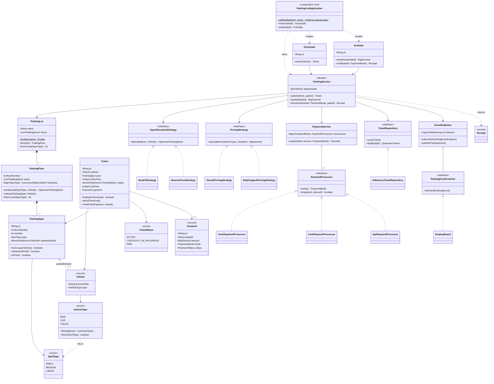
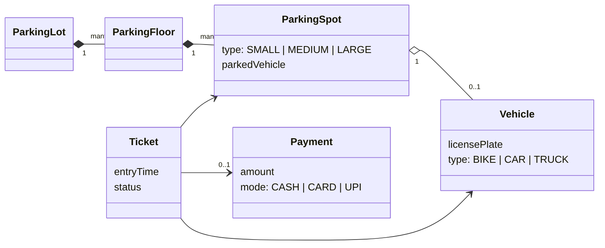
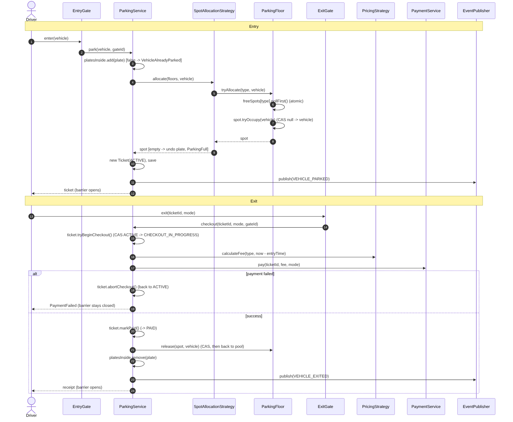
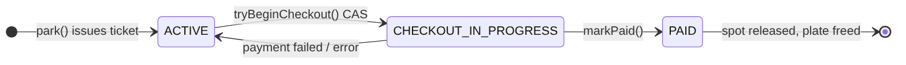

# Parking Lot: Low-Level Design Study Notes

*Target: SDE-2 LLD round. Java 17. Written 11 Oct 2026.*

These notes merge what the two resources you're following do well (vehicle and spot types, Strategy for fees and payments, a multi-floor Builder) and fix what they leave out: a real `Ticket`, thread-safe spot allocation, "no payment, no exit", one rate card instead of `switch` statements, and tests. The design is kept to what you can draw and code in a 45–60 minute round.

The working code sits next to this file. Run `./run.sh` for the demo and `./run.sh test` for the tests.

---

## Contents

1. [Requirements (say these first)](#1-requirements-say-these-first)
2. [The core ideas](#2-the-core-ideas)
3. [Class diagram](#3-class-diagram)
4. [The entities, and why they look like this](#4-the-entities-and-why-they-look-like-this)
5. [Entry: parking a vehicle](#5-entry-parking-a-vehicle)
6. [Spot allocation (Strategy)](#6-spot-allocation-strategy)
7. [Exit: fee, payment, release](#7-exit-fee-payment-release)
8. [Pricing (Strategy)](#8-pricing-strategy)
9. [Payments (Strategy + registry)](#9-payments-strategy--registry)
10. [Display board (Observer)](#10-display-board-observer)
11. [Multithreading and concurrency](#11-multithreading-and-concurrency)
12. [Design patterns used (and the ones left out)](#12-design-patterns-used-and-the-ones-left-out)
13. [SOLID, mapped to this design](#13-solid-mapped-to-this-design)
14. [Review of the resources](#14-review-of-the-resources)
15. [Extensions and scaling](#15-extensions-and-scaling)
16. [Tests](#16-tests)
17. [Interview playbook](#17-interview-playbook)
18. [One-page cheat sheet](#18-one-page-cheat-sheet)

---

## Project layout

```
Parking-Lot-LLD/
├── Parking-Lot-LLD-Study-Notes.md   <- this file
├── run.sh                           <- ./run.sh (demo)   ./run.sh test (tests)
├── docs/                            <- diagrams (.png, .svg, Mermaid .mmd source)
└── src/
    ├── main/java/com/lld/parkinglot/
    │   ├── model/        ParkingLot (+Builder), ParkingFloor, ParkingSpot, SpotType, Vehicle, VehicleType,
    │   │                 Ticket, TicketStatus, Payment, PaymentMode, PaymentStatus, Receipt
    │   ├── allocation/   SpotAllocationStrategy, BestFitStrategy, NearestFloorStrategy
    │   ├── pricing/      PricingStrategy, HourlyPricingStrategy, DailyCappedPricingStrategy
    │   ├── payment/      PaymentProcessor, Cash/Card/UpiPaymentProcessor, PaymentService
    │   ├── events/       EventPublisher, ParkingEventListener, ParkingEvent, ParkingEventType, DisplayBoard
    │   ├── repository/   TicketRepository, InMemoryTicketRepository
    │   ├── service/      ParkingService            <- the two use cases: park, checkout
    │   ├── gate/         EntryGate, ExitGate       <- thin front ends, one per physical gate
    │   ├── exception/    ParkingException + ParkingFull, VehicleAlreadyParked, TicketNotFound,
    │   │                 InvalidTicketState, PaymentFailed, UnsupportedPaymentMode
    │   ├── util/         Money, IdGenerator, MutableClock
    │   ├── ParkingLotApplication.java   <- composition root (wires everything)
    │   └── Main.java                    <- end-to-end demo, including a rush-hour race
    └── test/java/com/lld/parkinglot/ParkingLotTests.java   <- 14 tests, JDK only
```

---

## 1. Requirements (say these first)

**Functional**

| # | Requirement |
|---|---|
| F1 | The lot has **multiple floors**; each floor has spots of three sizes: **SMALL, MEDIUM, LARGE**. |
| F2 | Vehicles: **BIKE, CAR, TRUCK**. A vehicle may use a spot of its size **or bigger** (bike → any, car → medium/large, truck → large only). |
| F3 | **Multiple entry and exit gates**, working at the same time. |
| F4 | On entry the system assigns a spot and issues a **ticket** (entry time, spot, vehicle). If nothing fits, the vehicle is turned away. |
| F5 | On exit the system computes the **fee from the duration and vehicle type**, takes **payment (Cash / Card / UPI)**, frees the spot. |
| F6 | **Illegal actions**: a spot can't hold two vehicles; a vehicle can't leave without paying; the same vehicle can't be inside twice; a ticket can't be used twice. |
| F7 | A **display board** shows free spots per floor and type. |

**Non-functional**

| Concern | How the design handles it |
|---|---|
| **No double allocation** under concurrent entries (the big one) | Free-spot pool per floor and type; `pollFirst()` is atomic; the spot itself is a CAS (§11) |
| No double charge at two exit gates | Ticket status is a CAS state machine (§7, §11) |
| Gates must not block each other | No global lock; every shared structure is concurrent/atomic |
| Fast allocation | O(log n) per spot type per floor, not a scan of every spot |
| Extensible rules | Allocation, pricing and payment are Strategies; vehicle/spot types are enums |
| Money | `BigDecimal`, scale 2, never `double` |
| Testable time | `java.time.Clock` injected; tests "park for 3 hours" instantly |

**Out of scope (say so):** reservations/pre-booking, monthly passes, EV charging, handicapped spots, lost tickets, a persistent database, physical hardware (barrier, camera, ticket printer). §15 shows where each one would fit.

**Clarifying questions worth asking:**

- Can a smaller vehicle take a bigger spot? (We say yes, but only when its own size is full.)
- Hourly billing: is a started hour billed in full? Is there a minimum charge? A daily cap? A free grace period?
- Is payment taken at the exit gate, or at a pay station before walking back to the car?
- One lot or many (a chain of lots under one system)?
- Do we need the vehicle's plate at entry (camera / ANPR) or only a ticket?

---

## 2. The core ideas

Three sentences carry most of the design:

> **1. A floor keeps a pool of *free* spots per spot type, ordered nearest-first.** Taking a spot is one atomic `pollFirst()`, so finding a spot and taking it can't be split by another gate.

> **2. A ticket is a small state machine: `ACTIVE → CHECKOUT_IN_PROGRESS → PAID`,** moved with compare-and-set. The spot is freed only after the move to `PAID`, so there is no exit without payment and no double charge.

> **3. Everything that varies is a Strategy or an enum, not a subclass.** Which spot (allocation), how much (pricing), how to pay (payment processor) are interfaces; vehicle and spot types are enums with data.

Everything else is ordinary layering around those three.

---

## 3. Class diagram

### 3.1 Full picture



*Zoomable: `docs/class-diagram.svg`. Mermaid source: `docs/class-diagram.mmd`.*

Read it top to bottom: **Gates → `ParkingService` (facade) → Strategies, `PaymentService`, repository, events → the physical model (`ParkingLot` ◆ `ParkingFloor` ◆ `ParkingSpot`)**.

Relationships and what they mean:

- **ParkingLot ◆— ParkingFloor ◆— ParkingSpot** (composition): spots don't exist outside their floor, floors not outside the lot. The structure is built once (Builder) and never changes; only occupancy changes.
- **ParkingSpot o— 0..1 Vehicle**: the spot's single piece of mutable state, an `AtomicReference<Vehicle>`.
- **Ticket → Vehicle, ParkingSpot, 0..1 Payment**: the ticket is the record of one stay.
- **ParkingService → interfaces only** (`SpotAllocationStrategy`, `PricingStrategy`, `TicketRepository`, `PaymentService`'s `PaymentProcessor`s, `EventPublisher`'s listeners). Concrete classes are chosen in `ParkingLotApplication`.

### 3.2 The whiteboard version (draw this first)



Six boxes. Draw these in the first 10 minutes, then add the strategies and the service around them.

### 3.3 Entry and exit, step by step



### 3.4 Ticket state machine



```java
public enum TicketStatus {
    ACTIVE,                 // car is inside
    CHECKOUT_IN_PROGRESS,   // one exit gate is taking payment; any other gate is refused
    PAID                    // spot freed, plate freed; the ticket is dead
}
```

---

## 4. The entities, and why they look like this

### 4.1 Vehicle: a record, not a class hierarchy

Both resources make `Vehicle` abstract with `Car`, `Bike`, `Truck` subclasses (plus a `VehicleFactory`). But the subclasses add **no behaviour** — they're empty constructors. A subclass that adds nothing is just a type tag, and an enum is a better type tag:

```java
public record Vehicle(String licensePlate, VehicleType type) {
    public Vehicle {
        licensePlate = licensePlate.replaceAll("[\\s-]", "").toUpperCase();   // "ka 01 ab-1234" == "KA01AB1234"
        if (licensePlate.isEmpty()) throw new IllegalArgumentException("licensePlate is blank");
    }
}
```

Immutable (safe to share between threads), `equals`/`hashCode` for free, and the plate is normalised so the "same car twice" check can't be dodged with a space.

> **When would subclasses be right?** When types behave differently: e.g. an `ElectricCar` that needs a charging spot and is billed for kWh. Say this out loud; it shows you chose the enum on purpose.

### 4.2 The fit rule lives in `VehicleType`

```java
public enum VehicleType {
    BIKE(List.of(SpotType.SMALL, SpotType.MEDIUM, SpotType.LARGE)),
    CAR(List.of(SpotType.MEDIUM, SpotType.LARGE)),
    TRUCK(List.of(SpotType.LARGE));

    private final List<SpotType> fittingSpots;            // smallest (best fit) first
    public List<SpotType> fittingSpots() { return fittingSpots; }
    public boolean fitsIn(SpotType spotType) { return fittingSpots.contains(spotType); }
}
```

One table, one place. The resources put this rule in `CarParkingSpot.canParkVehicle()` / `BikeParkingSpot.canParkVehicle()` with string comparisons, so "a bike may use a car spot" means editing several classes. Here it's one line. Adding `BUS` is one enum constant plus a rate.

### 4.3 ParkingSpot: one class, one atomic field

```java
public final class ParkingSpot implements Comparable<ParkingSpot> {
    private final String id;            // "F1-M07": floor 1, medium, spot 7
    private final int floorNumber, number;
    private final SpotType type;
    private final AtomicReference<Vehicle> parkedVehicle = new AtomicReference<>();

    public boolean tryOccupy(Vehicle v) {
        if (!v.type().fitsIn(type)) throw new IllegalArgumentException(v.type() + " does not fit in a " + type + " spot");
        return parkedVehicle.compareAndSet(null, v);          // only one thread can win
    }
    public boolean release(Vehicle v) { return parkedVehicle.compareAndSet(v, null); }  // only the parked vehicle can leave
    public int compareTo(ParkingSpot o) { return Integer.compare(number, o.number); }  // lower number = nearer
}
```

No `isOccupied` boolean next to a `vehicle` field (two fields that must agree): "free" is simply `parkedVehicle == null`.

### 4.4 ParkingLot: built once with a Builder

```java
ParkingLot lot = ParkingLot.builder("City Mall")
        .addFloor(0, 2, 3, 1)      // floor 0: 2 small, 3 medium, 1 large
        .addFloor(1, 2, 3, 0)
        .build();
```

The Builder numbers spots nearest-first, rejects duplicate floors and negative counts, and returns an object whose structure is immutable. That immutability is what makes it safe to read `lot.floors()` from every gate thread without locks.

### 4.5 Ticket

```java
public final class Ticket {
    private final String id;
    private final Vehicle vehicle;
    private final ParkingSpot spot;
    private final Instant entryTime;
    private final String entryGateId;
    private final AtomicReference<TicketStatus> status = new AtomicReference<>(TicketStatus.ACTIVE);
    private volatile Instant exitTime;      // set once, at checkout
    private volatile Payment payment;
    // tryBeginCheckout(), abortCheckout(), markPaid(...) : see §7
}
```

Neither resource actually has a ticket class, even though "each vehicle is issued a ticket" is in the rules. Without it, the fee needs the caller to pass a duration in by hand (`calculateFee(2, HOURS)`), and nothing stops the same exit happening twice.

---

## 5. Entry: parking a vehicle

```java
public Ticket park(Vehicle vehicle, String entryGateId) {
    String plate = vehicle.licensePlate();
    if (!platesInside.add(plate)) throw new VehicleAlreadyParkedException(plate);   // atomic check-and-reserve

    ParkingSpot spot;
    try {
        spot = allocationStrategy.allocate(lot.floors(), vehicle)
                .orElseThrow(() -> new ParkingFullException(vehicle.type()));
    } catch (RuntimeException e) {
        platesInside.remove(plate);          // undo, so the car can try again later
        throw e;
    }

    Ticket ticket = new Ticket(ticketIds.next(), vehicle, spot, clock.instant(), entryGateId);
    tickets.save(ticket);
    events.publish(new ParkingEvent(ParkingEventType.VEHICLE_PARKED, ticket, ticket.entryTime()));
    return ticket;
}
```

Three things to point at:

1. **`platesInside.add(plate)`** — `ConcurrentHashMap.newKeySet().add` is atomic and returns `false` if the plate is already there. `if (!contains) add` would be a race (two gates both see "not inside"). The tests prove it (§16).
2. **The allocation returns a spot that is already taken** by this vehicle. There's no window between "found a free spot" and "marked it occupied".
3. **Undo on failure.** If the lot is full we must release the plate we reserved, or that car could never enter again.

---

## 6. Spot allocation (Strategy)

### 6.1 The free-spot pool

```java
public final class ParkingFloor {
    private final Map<SpotType, ConcurrentSkipListSet<ParkingSpot>> freeSpots = new EnumMap<>(SpotType.class);

    public Optional<ParkingSpot> tryAllocate(SpotType type, Vehicle vehicle) {
        ConcurrentSkipListSet<ParkingSpot> pool = freeSpots.get(type);
        ParkingSpot spot;
        while ((spot = pool.pollFirst()) != null) {           // atomic remove-and-return: one thread gets it
            if (spot.tryOccupy(vehicle)) return Optional.of(spot);
        }
        return Optional.empty();
    }

    public void release(ParkingSpot spot, Vehicle vehicle) {
        if (!spot.release(vehicle)) throw new IllegalStateException(vehicle.licensePlate() + " is not parked at " + spot);
        freeSpots.get(spot.type()).add(spot);                 // back in the pool only AFTER it is free
    }
}
```

Why a `ConcurrentSkipListSet`:

| Need | How it's met |
|---|---|
| Two gates must never get the same spot | `pollFirst()` removes and returns atomically |
| Nearest spot first | Sorted by spot number (`Comparable`) |
| Fast | O(log n), instead of scanning every spot on every floor |
| No locks | Lock-free; gates never wait on each other |

A `ConcurrentLinkedQueue` would also be atomic and O(1), but it gives you "whatever was freed first", not "nearest". Pick the queue if order doesn't matter.

### 6.2 Two strategies

```java
public interface SpotAllocationStrategy {
    Optional<ParkingSpot> allocate(List<ParkingFloor> floors, Vehicle vehicle);   // returns an already-occupied spot
}

/** Default. Smallest fitting size anywhere in the lot, then the next size up. */
public class BestFitStrategy implements SpotAllocationStrategy {
    public Optional<ParkingSpot> allocate(List<ParkingFloor> floors, Vehicle vehicle) {
        for (SpotType type : vehicle.type().fittingSpots())
            for (ParkingFloor floor : floors) {
                Optional<ParkingSpot> spot = floor.tryAllocate(type, vehicle);
                if (spot.isPresent()) return spot;
            }
        return Optional.empty();
    }
}
```

`NearestFloorStrategy` is the same two loops swapped: floor outside, size inside.

| | BestFit (size, then floor) | NearestFloor (floor, then size) |
|---|---|---|
| A bike, when floor 0 has only a car spot free and floor 1 has a bike spot | Floor 1, SMALL | Floor 0, MEDIUM |
| Good for | Keeping big spots for big vehicles | Short walks |
| Risk | Drivers sent upstairs | Bikes fill car spots; cars turned away while bike spots sit empty |

Other strategies an interviewer might ask for, each one new class: nearest to the entry gate the car came in by (needs gate → spot distances), spread load across floors (most free first), reserved/VIP spots first.

---

## 7. Exit: fee, payment, release

```java
public Receipt checkout(String ticketId, PaymentMode mode, String exitGateId) {
    Ticket ticket = find(ticketId);
    if (!ticket.tryBeginCheckout())                                  // CAS ACTIVE -> CHECKOUT_IN_PROGRESS
        throw new InvalidTicketStateException(ticketId, ticket.status());

    Instant exitTime = clock.instant();
    Duration parkedFor = Duration.between(ticket.entryTime(), exitTime);
    Payment payment;
    try {
        BigDecimal fee = pricingStrategy.calculateFee(ticket.vehicle().type(), parkedFor);
        payment = paymentService.pay(ticket.id(), fee, mode);
    } catch (RuntimeException e) {
        ticket.abortCheckout();                                      // e.g. unsupported mode
        throw e;
    }
    if (payment.status() != PaymentStatus.SUCCESS) {
        ticket.abortCheckout();                                      // back to ACTIVE; car still in its spot
        throw new PaymentFailedException(ticketId, mode);
    }

    ticket.markPaid(payment, exitTime);                              // CHECKOUT_IN_PROGRESS -> PAID
    lot.floor(ticket.spot().floorNumber()).release(ticket.spot(), ticket.vehicle());
    platesInside.remove(ticket.vehicle().licensePlate());
    events.publish(new ParkingEvent(ParkingEventType.VEHICLE_EXITED, ticket, exitTime));
    return new Receipt(...);
}
```

How this enforces the rules:

| Rule | Mechanism |
|---|---|
| No exit without payment | The spot is released only after `markPaid`; on failure the method throws and the barrier stays shut |
| Payment can fail and be retried | `abortCheckout()` puts the ticket back to `ACTIVE`; the driver tries cash |
| Same ticket at two exit gates | Only one `tryBeginCheckout()` CAS succeeds; the other gate gets `InvalidTicketStateException` **before** any charge |
| Paid ticket reused | Status is `PAID`, CAS fails |
| Fee can't be faked | Duration comes from the ticket's stored entry time and the injected clock, never from the caller |

Why the middle state `CHECKOUT_IN_PROGRESS`? Payment is slow (a card terminal takes seconds). If we went straight `ACTIVE → PAID` after paying, two gates could both be paying at the same time and the driver would be charged twice. Claiming the ticket first, then paying, is the same idea as the seat hold in the movie-ticket design.

`quote(ticketId)` gives the "you owe Rs 120" screen before the driver picks a payment mode. It doesn't change any state.

---

## 8. Pricing (Strategy)

```java
public interface PricingStrategy {
    BigDecimal calculateFee(VehicleType vehicleType, Duration parkedFor);

    /** Any started hour is billed; minimum one hour. 0-60 min = 1h, 61 min = 2h. */
    static long billableHours(Duration parkedFor) {
        long seconds = parkedFor.toSeconds() + (parkedFor.toNanosPart() > 0 ? 1 : 0);
        return Math.max(1, (seconds + 3599) / 3600);
    }
}

public class HourlyPricingStrategy implements PricingStrategy {
    private final Map<VehicleType, BigDecimal> hourlyRates;      // a rate card, validated to cover every type
    public BigDecimal calculateFee(VehicleType type, Duration parkedFor) {
        return Money.times(hourlyRates.get(type), PricingStrategy.billableHours(parkedFor));
    }
}
```

`DailyCappedPricingStrategy`: hourly, but each 24-hour block costs at most the cap. Car at Rs 40/h with a Rs 300 cap: 3h → 120, 10h → 300, 26h → 300 + 80 = 380.

What changed from the resources:

- **Rates are data, not a `switch`.** `BasicHourlyRateStrategy` and `PremiumRateStrategy` in the article are the same `switch` with different numbers, keyed on a lowercase string (`"car"`, `"bike"`). A typo silently falls to the `default` rate, and adding a vehicle type means editing every strategy (OCP violation). An `EnumMap` rate card fixes both; "premium" becomes the same class with a different map.
- **Duration comes from the ticket**, not a `(int duration, DurationType)` pair the caller makes up.
- **`BigDecimal`, scale 2.** `double` can't represent 0.1 exactly; money sums drift.
- **The strategy is chosen per lot**, not per vehicle. The article stores a fee strategy inside each `Vehicle`, which mixes "what the vehicle is" with "what this lot charges".

Real-world rules that slot in as new strategies or decorators: free first 15 minutes (grace period), weekend/night rates, monthly-pass holders pay 0. If several rules must stack, wrap strategies in decorators (`new GracePeriod(new WeekendSurcharge(new Hourly(...)))`), as in the movie-ticket pricing.

---

## 9. Payments (Strategy + registry)

```java
public interface PaymentProcessor {
    PaymentMode mode();
    boolean charge(String reference, BigDecimal amount);
}

public class PaymentService {
    private final Map<PaymentMode, PaymentProcessor> processors = new EnumMap<>(PaymentMode.class);

    public Payment pay(String ticketId, BigDecimal amount, PaymentMode mode) {
        PaymentProcessor processor = processors.get(mode);
        if (processor == null) throw new UnsupportedPaymentModeException(mode);
        boolean ok;
        try { ok = processor.charge(ticketId, amount); }
        catch (RuntimeException e) { ok = false; }                     // gateway error = failed payment
        return new Payment(ids.next(), ticketId, amount, mode, ok ? SUCCESS : FAILED, clock.instant());
    }
}
```

- **Strategy**: one class per mode (`CashPaymentProcessor`, `CardPaymentProcessor`, `UpiPaymentProcessor`).
- **Registry instead of a factory `switch`**: processors register by their `mode()`. Adding FASTag = one class, one line at startup. The article's `getPaymentStrategy(int choice)` `switch` has to be edited for every new mode, and quietly falls back to card on a bad choice.
- **Adapter seam**: a real Razorpay/Stripe client sits behind `PaymentProcessor`; tests plug in a processor that declines or throws.
- Every attempt (including failures) becomes a `Payment` record, which is what an audit or a dispute needs.

---

## 10. Display board (Observer)

```java
@FunctionalInterface
public interface ParkingEventListener { void onEvent(ParkingEvent event); }

public class EventPublisher {
    private final List<ParkingEventListener> listeners = new CopyOnWriteArrayList<>();
    public void subscribe(ParkingEventListener l) { listeners.add(l); }
    public void publish(ParkingEvent event) {
        for (ParkingEventListener l : listeners) {
            try { l.onEvent(event); }
            catch (RuntimeException e) { System.err.println("Listener failed: " + e.getMessage()); }
        }
    }
}

public class DisplayBoard implements ParkingEventListener {
    private volatile String current;
    public void onEvent(ParkingEvent e) { current = render(); }    // reads lock-free free counts per floor/type
}
```

- `ParkingService` doesn't know who listens. The display board, an SMS "your car has left" notifier, analytics, an audit log: each is one listener (Open/Closed).
- `CopyOnWriteArrayList`: publishes happen from many gate threads all the time, subscribes almost never; iteration needs no lock and never throws `ConcurrentModificationException`.
- **A failing listener can't break parking.** The SMS service being down must not stop the barrier from opening. The tests check this.
- Events are published **after** the state change, so a listener never sees a half-done park.

Board numbers are a snapshot. With many gates the board can be a moment behind, which is fine for a sign. (Two events rendering at once can also finish out of order; if that mattered, render on read instead of on event.)

---

## 11. Multithreading and concurrency

This is where an SDE-2 round is usually decided. Have the table in §11.1 ready.

### 11.1 What is shared, and what can go wrong

Every gate is a thread calling the same `ParkingService`.

| Shared state | Race if done naively | Fix in this design |
|---|---|---|
| Spot occupancy | Gate A and gate B both scan, both see spot 7 free, both park there | Free pool `pollFirst()` (atomic) + spot CAS `null → vehicle` |
| Plates inside | Same car at two gates (or a cloned plate) both pass "not inside" | `Set.add()` on a concurrent set: check-and-insert in one step |
| Ticket status | Two exit gates both read `ACTIVE`, both charge | CAS `ACTIVE → CHECKOUT_IN_PROGRESS` before charging |
| Ticket store | `HashMap` corrupted by concurrent `put` | `ConcurrentHashMap` |
| Ids | Two tickets get id 42 | `AtomicLong.incrementAndGet()` |
| Listener list | `ConcurrentModificationException` while publishing | `CopyOnWriteArrayList` |

The classic bug, which is exactly the article's `ParkingLot.parkVehicle`:

```java
ParkingSpot spot = findAvailableSpot(type);   // thread A and B both get spot 7
spot.parkVehicle(vehicle);                    // A parks; B throws "already occupied" (or, without the check, overwrites A)
```

This is **check-then-act**: the check and the act are two steps, and another thread can run between them.

### 11.2 Options, from simplest to best

| Option | How | Pros | Cons |
|---|---|---|---|
| 1. `synchronized park()/checkout()` on the service (or a Singleton lot) | One global lock | Trivially correct; fine to say first | All gates queue behind one lock; a slow card payment inside the lock blocks every entry |
| 2. Lock per floor | `ReentrantLock` per floor, scan inside | Floors in parallel | Still scans; needs care if a strategy looks at several floors |
| 3. Lock per spot (`tryLock`) | Scan, `tryLock` a candidate, re-check, occupy | Fine-grained | Lots of locks; scanning still O(n) |
| **4. Lock-free (this design)** | Atomic pool per (floor, type) + CAS on spot and ticket | No waiting, no deadlock possible, O(log n) | Must think about ordering (below) |

A good way to answer: *"The simplest correct version is a synchronized `park`. It serialises every gate, and if payment is inside the lock it's worse. So I make each step atomic where the data lives: a concurrent free pool, a CAS on the spot, a CAS on the ticket."*

### 11.3 The orderings that matter

These are the subtle bits; each one is a deliberate line in the code.

1. **Release: free the spot first, then return it to the pool.**
   ```java
   spot.release(vehicle);                 // CAS vehicle -> null
   freeSpots.get(spot.type()).add(spot);  // now visible to other gates
   ```
   The other way round, a gate could `pollFirst()` the spot while it still holds the old car, `tryOccupy` would fail, and the spot would be dropped from the pool forever (a leaked spot).

2. **Claim the ticket before charging.** `tryBeginCheckout()` happens before `paymentService.pay(...)`, so the losing gate is turned away without charging.

3. **Mark paid before releasing the spot.** If the spot were freed first and `markPaid` then failed, a car would be out without a paid ticket.

4. **Undo partial work.** Plate reserved but lot full → remove the plate. Payment failed → `abortCheckout()`.

5. **Publish events last**, after all state is consistent.

### 11.4 Visibility (the Java Memory Model part)

- `AtomicReference`, `ConcurrentSkipListSet`, `ConcurrentHashMap` give **happens-before**: whatever a thread wrote before a successful CAS/insert is visible to the thread that later reads it.
- In `Ticket.markPaid`, `payment` and `exitTime` are written **before** the status CAS to `PAID`. Any thread that sees `PAID` also sees them. They're `volatile` as well, which makes the intent obvious.
- `ParkingLot`, `ParkingFloor`'s lists and maps, `Vehicle`, `Payment`, `Receipt` are **immutable after construction** (`final` fields, `List.copyOf`, records). Immutable objects are safe to share with no synchronisation at all.

### 11.5 Why no deadlock is possible

There are no locks. Every operation is a single atomic step on one object, and no thread ever waits while holding something another thread needs. (If you choose option 2 or 3 in an interview, mention lock ordering — always lock floors/spots in ascending id order — and `tryLock(timeout)`.)

### 11.6 What would change with a database

In production the in-memory atomics become conditional writes:

```sql
-- take a spot: one statement, atomic per row; SKIP LOCKED lets many gates grab different rows at once
SELECT id FROM spot
 WHERE lot_id = ? AND type = 'MEDIUM' AND vehicle_plate IS NULL
 ORDER BY floor, number
 LIMIT 1 FOR UPDATE SKIP LOCKED;
UPDATE spot SET vehicle_plate = ? WHERE id = ? AND vehicle_plate IS NULL;    -- check rows updated = 1

-- one active ticket per plate
CREATE UNIQUE INDEX one_active_ticket ON ticket(plate) WHERE status <> 'PAID';  -- partial index (Postgres)

-- claim a ticket for checkout
UPDATE ticket SET status = 'CHECKOUT_IN_PROGRESS' WHERE id = ? AND status = 'ACTIVE';  -- rows = 1 or someone else has it
```

Same three ideas, same CAS shape: "change it only if it's still what I expect, and check whether I won".

### 11.7 Proving it

The tests release all threads together with a `CountDownLatch` and check invariants afterwards (§16). They were also run against deliberately broken code: replacing `platesInside.add` with `contains`-then-`add`, and the ticket CAS with get-then-set, makes the two race tests fail. That's how you know the tests test something.

---

## 12. Design patterns used (and the ones left out)

| Pattern | Where | The line to say |
|---|---|---|
| **Strategy** | `SpotAllocationStrategy`, `PricingStrategy`, `PaymentProcessor` | "Which spot, how much, how to pay: each is a swappable class; `ParkingService` never changes." |
| **Facade** | `ParkingService` | "Gates call two methods; the service coordinates allocation, pricing, payment, storage and events." |
| **Observer** | `EventPublisher` → `DisplayBoard` (and any notifier) | "Parking publishes events; boards and SMS subscribe. A failing listener can't stop the barrier." |
| **Builder** | `ParkingLot.builder().addFloor(...).build()` | "Readable multi-floor setup, validated in one place, immutable result." |
| **State machine** (enum + CAS) | `TicketStatus` | "Illegal moves like PAID → PAID are impossible, even across threads." |
| **Registry** (instead of a Factory switch) | `PaymentService` map of `PaymentMode → PaymentProcessor` | "New payment mode = new class, no edits." |
| **Repository** | `TicketRepository` + in-memory impl | "The service doesn't know if tickets live in a map or Postgres." |
| **Adapter / port** | `PaymentProcessor` | "A real gateway SDK is adapted behind one interface; tests use a fake." |
| **Dependency Injection** | `ParkingLotApplication` | "One composition root picks the concrete classes." |
| **Immutable value objects** | `Vehicle`, `Payment`, `Receipt`, `ParkingEvent` | "Safe to share across gate threads." |

### 12.1 Singleton: why the resources use it and why this code doesn't

Interviewers often expect "`ParkingLot` is a Singleton, there's only one lot". Know how to write one, and know why you'd rather not:

```java
// If asked: thread-safe lazy Singleton (initialization-on-demand holder). The JVM guarantees the
// holder class is initialised once, by one thread, on first use. No synchronized, no volatile needed.
public final class ParkingLotRegistry {
    private ParkingLotRegistry() {}
    private static class Holder { static final ParkingLotRegistry INSTANCE = new ParkingLotRegistry(); }
    public static ParkingLotRegistry getInstance() { return Holder.INSTANCE; }
}
// (An enum singleton is the other safe option. Double-checked locking also works, but only with a volatile field.)
```

Why this design uses DI instead:

- **Tests**: a Singleton carries state from one test to the next. Here each test builds a fresh lot in one line.
- **"One lot" is a deployment fact, not a class rule.** A company runs many lots; a Singleton makes that a rewrite.
- **Hidden dependencies**: `ParkingLot.getInstance()` inside a method hides what the method needs. Constructor injection shows it.

The composition root (`ParkingLotApplication`) creates exactly one lot per app, which gives you "only one" without the global.

### 12.2 Factory: why there isn't a `VehicleFactory`

The article's `VehicleFactory.createVehicle("Car", ...)` exists to choose between empty subclasses. With `new Vehicle(plate, VehicleType.CAR)` there's nothing to choose. A factory earns its place when construction is complicated or the concrete class must be hidden; neither is true here. (`PaymentService`'s registry plays the "pick an implementation by key" role where one is actually needed.)

---

## 13. SOLID, mapped to this design

| Principle | Where you can point to it |
|---|---|
| **S**ingle responsibility | `ParkingFloor` manages its free pool; `ParkingService` runs the two use cases; pricing, allocation and payment are separate classes; gates only adapt hardware to calls |
| **O**pen/closed | New allocation rule, price rule, payment mode or listener = new class; nothing existing is edited. New vehicle type = one enum constant + one rate |
| **L**iskov substitution | Any `PricingStrategy` / `SpotAllocationStrategy` / `PaymentProcessor` can replace another; tests swap in declining and throwing processors |
| **I**nterface segregation | Tiny interfaces: one method each for allocation, pricing, listener; two for payment |
| **D**ependency inversion | `ParkingService` depends on interfaces; concrete choices live only in `ParkingLotApplication` |

---

## 14. Review of the resources

### 14.1 codewitharyan — "Design Parking Lot"

**Good, and kept:** vehicle and spot sizes, Strategy for fees and for payments, `ParkingFloor` + a Builder for multi-floor lots, and a clean statement of the "illegal actions".

**Gaps, and how this design fills them:**

| # | In the article | Problem | Here |
|---|---|---|---|
| 1 | `findAvailableSpot()` then `spot.parkVehicle()` | Check-then-act race: two gates pick the same spot. Concurrency is listed as a challenge but never handled | Atomic pool + CAS (§11) |
| 2 | No `Ticket` class | The rules require a ticket; fee duration is typed in by hand; nothing stops a second exit | `Ticket` with entry time and a CAS state machine (§4.5, §7) |
| 3 | Payment and exit aren't linked; `processPayment` returns `void` | A failed payment can't stop the exit; "no exit without payment" isn't enforced | Spot released only after `PAID`; failure rolls back to `ACTIVE` |
| 4 | Vehicle type as a `String` with `switch` in every fee strategy | Typos fall to the default rate; every new type edits every strategy (OCP) | `VehicleType` enum + `EnumMap` rate card |
| 5 | Fee strategy stored inside each `Vehicle` | A vehicle doesn't decide what the lot charges | One `PricingStrategy` per lot |
| 6 | `double` for money | Rounding errors | `BigDecimal`, scale 2 |
| 7 | Empty `Car`/`Bike` subclasses + `VehicleFactory`; `CarParkingSpot`/`BikeParkingSpot` | Classes with no behaviour; fit rule spread across classes | Record + enums; fit rule in one table (§4) |
| 8 | Exact-match spots only (`spotType.equals(vehicleType)`) | A bike can't use an empty car spot | Fit list, best fit first (§6) |
| 9 | Linear scan of all spots | O(spots) per entry, under a lock if made safe | O(log n) pool per type and floor |
| 10 | Singleton and Observer named in the approach but not implemented | — | Observer implemented; Singleton discussed and replaced by DI (§12.1) |
| 11 | No check that the same plate isn't already inside | — | `platesInside` concurrent set |
| 12 | Builder bug: `new OtherVehicle(...)` added as a *spot*; `CashPayment(fee)` constructor ignores `fee` | Wouldn't compile / dead parameter | — |

### 14.2 GitHub — nailyourinterview `parking_lot` package

I couldn't open this one: GitHub blocks automated reading of that folder page, so it hasn't been compared line by line. If you attach the files (or paste the class list), this section can be filled in with a proper comparison.

---

## 15. Extensions and scaling

Likely follow-ups and where each fits. None needs the core to change.

| Follow-up | Where it goes |
|---|---|
| **EV charging spots** | New `SpotType.EV` (or a `features` set on the spot); `VehicleType.EV_CAR` fits EV first; an extra charge line via a pricing decorator |
| **Handicapped / reserved / VIP spots** | Separate pools; an allocation strategy that checks the vehicle's permit first |
| **Spot out of service** | `ParkingFloor.disable(spot)`: remove from pool (atomically) and mark; `enable` adds back |
| **Lost ticket** | Lookup by plate (change `platesInside` set to a `plate → ticketId` map); charge a lost-ticket fee strategy |
| **Pay at a kiosk, then exit** | Split checkout: `pay()` moves to `PAID` with a 15-minute exit window; `exit()` frees the spot. Late exit → charge the difference |
| **Grace period / night rates / monthly pass** | New `PricingStrategy` or decorator |
| **Reservations** | A spot gets a third state `RESERVED(until)`; a lease with expiry, exactly like the movie-ticket seat hold |
| **Many lots, one system** | `lotId` on everything; one `ParkingLotApplication` (or service instance) per lot; route gates by lot |

**Persistence (if asked for a schema):**

```
parking_lot(id, name, address)
floor(id, lot_id, floor_number)
spot(id, floor_id, number, type, vehicle_plate NULL)        idx (floor_id, type) where vehicle_plate is null
ticket(id, lot_id, plate, vehicle_type, spot_id, entry_time, exit_time, status, amount)
        UNIQUE (plate) WHERE status <> 'PAID'               -- one active ticket per plate
payment(id, ticket_id, amount, mode, status, gateway_ref, created_at)
```

**Scaling notes:** one lot is small (a few thousand spots, a handful of gates), so one service instance with a database is plenty; the concurrency is within the lot. Across many lots, partition by `lot_id`. Free counts for apps ("200 spots free at Mall X") can be cached and updated from the events. Gates should keep working if the network drops: issue tickets locally and sync later (worth one sentence).

---

## 16. Tests

`./run.sh test` runs 14 tests with only a JDK:

```
PASS  fit rules: bike->SMALL first, car never in SMALL, truck only LARGE
PASS  best fit vs nearest floor: different spot for the same bike
PASS  lot full -> ParkingFullException, and the plate can try again later
PASS  same plate twice (normalised) is rejected while inside
PASS  pricing: min 1 hour, any started hour billed, daily cap
PASS  checkout: fee, receipt, spot and plate freed, board updated
PASS  paid ticket cannot be used again; unknown ticket rejected
PASS  payment failure: barrier stays closed, ticket ACTIVE, retry with cash works
PASS  unsupported payment mode is rejected and the ticket stays ACTIVE
PASS  a failing listener never breaks parking (Observer isolation)
PASS  200 vehicles, 8 gates, 50 spots: exactly 50 tickets, no spot shared
PASS  same plate at 10 gates at once: exactly one ticket
PASS  same ticket at 2 exit gates at once: charged exactly once
PASS  churn: 16 threads park/exit 2,000 times; never two vehicles in a spot

14 passed, 0 failed
```

- Concurrency tests start all threads together with a `CountDownLatch` and use `awaitTermination(timeout)`, so a hang shows up as a failure.
- The double-exit test runs 50 rounds with a slow (2 ms) payment processor, to widen the race window.
- The churn test ends by checking every spot is free and every pool count equals capacity: no leaked or duplicated spots.
- Mutation check: making the plate check `contains`-then-`add`, or the ticket claim get-then-set, fails the matching race test.
- Time is a `MutableClock`, so "2 hours 10 minutes later" is instant.

`./run.sh` runs the demo: three vehicles enter, a duplicate plate and a second truck are refused, the car and bike pay and leave, then 40 cars race through 4 gates for the 6 remaining car-sized spots (6 tickets, 6 distinct spots, 34 turned away).

---

## 17. Interview playbook

### A 45–60 minute round, in order

| Minutes | What to do |
|---|---|
| 0–5 | Requirements, out of scope, clarifying questions (§1) |
| 5–12 | Draw the six-box domain model (§3.2); enums for vehicle/spot types and the fit table (§4) |
| 12–20 | Entry flow: plate check, allocation strategy, ticket (§5, §6) |
| 20–30 | Exit flow: ticket state machine, pricing strategy, payment strategy (§7–§9) |
| 30–42 | Concurrency: the check-then-act race, options table, the atomic pool + CAS answer (§11) |
| 42–50 | Display board (Observer), patterns and SOLID summary (§10, §12, §13) |
| 50+ | Follow-ups: EV, reservations, lost ticket, DB version (§15, §11.6) |

### Likely follow-ups, with short answers

- **"Two cars arrive at two gates and there's one spot left?"** The pool's `pollFirst()` is atomic: one gate gets the spot, the other gets an empty result and turns the car away.
- **"Why not just make `park()` synchronized?"** It's correct, and a fine first answer. But it serialises all gates, and if payment is inside it, one slow card blocks every entry. Atomic per-structure updates let gates run in parallel.
- **"Can a bike park in a car spot?"** Yes, when bike spots are full. The fit list is smallest first; best-fit tries every floor's small spots before any medium one.
- **"How do you stop leaving without paying?"** The spot is released only after the ticket is `PAID`. A failed payment rolls back to `ACTIVE` and the barrier stays shut.
- **"Same ticket at two exits?"** CAS `ACTIVE → CHECKOUT_IN_PROGRESS`. The second gate is refused before anything is charged.
- **"Add a new vehicle type / payment mode / pricing rule?"** Enum constant + rate / new `PaymentProcessor` / new `PricingStrategy`. No existing class changes.
- **"Is `ParkingLot` a Singleton?"** Show the holder idiom (§12.1), then explain why DI with one composition root is better for tests and multi-lot.
- **"How would this look with a database?"** `SELECT … FOR UPDATE SKIP LOCKED` + conditional `UPDATE`, a partial unique index on active tickets per plate, and a conditional update for checkout (§11.6).
- **"What about the display board under load?"** Lock-free counts; snapshot may be a moment stale, which is fine for a sign.

### Lines worth memorising

> "A floor keeps a pool of free spots per size. Taking one is an atomic pollFirst, so 'find' and 'take' can't be split."

> "Release order matters: free the spot first, then put it back in the pool."

> "A ticket goes ACTIVE → CHECKOUT_IN_PROGRESS → PAID by compare-and-set. Claim first, then charge. That's what prevents double charging."

> "Car and Bike subclasses add no behaviour, so they're an enum. If an electric car needed different behaviour, that's when I'd subclass."

> "Allocation, pricing and payment are strategies; the service only coordinates."

---

## 18. One-page cheat sheet

```
ENTITIES   ParkingLot ◆ ParkingFloor ◆ ParkingSpot(id, type, AtomicRef<Vehicle>)
           Vehicle(plate, VehicleType) record · Ticket(vehicle, spot, entryTime, status, payment) · Payment · Receipt
ENUMS      SpotType SMALL<MEDIUM<LARGE · VehicleType BIKE{S,M,L} CAR{M,L} TRUCK{L} (fit list, smallest first)
           TicketStatus ACTIVE -> CHECKOUT_IN_PROGRESS -> PAID ; CHECKOUT_IN_PROGRESS -> ACTIVE on failure
ENTRY      platesInside.add(plate) [false -> already parked] · strategy.allocate -> already-occupied spot
           [none -> undo plate, ParkingFull] · Ticket ACTIVE · publish PARKED
ALLOCATE   per floor: EnumMap<SpotType, ConcurrentSkipListSet<Spot>> free pool · pollFirst() atomic + nearest
           then spot CAS null->vehicle · BestFit (size, then floor) vs NearestFloor (floor, then size)
EXIT       CAS ACTIVE->CHECKOUT · fee = pricing(type, now - entry) · pay(mode)
           fail -> abort to ACTIVE, barrier shut · ok -> PAID, release spot (CAS, THEN back to pool),
           remove plate, publish EXITED, receipt
PRICING    Strategy · billable hours = ceil, min 1 · EnumMap rate card · daily cap variant · BigDecimal
PAYMENT    PaymentProcessor per mode (Strategy/Adapter) · EnumMap registry, not a switch · error = FAILED
OBSERVER   EventPublisher (CopyOnWriteArrayList) -> DisplayBoard, notifiers · listener errors isolated
THREADS    no global lock · atomic set / pool / CAS / ConcurrentHashMap / AtomicLong ids · immutable structure
           orderings: release-then-add · claim-then-charge · paid-then-release · undo partial work · publish last
SINGLETON  holder idiom if asked; prefer DI via ParkingLotApplication (tests, multi-lot)
DB         SELECT ... FOR UPDATE SKIP LOCKED + UPDATE ... WHERE plate IS NULL · unique active ticket per plate
           UPDATE ticket SET status=CHECKOUT WHERE id=? AND status=ACTIVE
```
